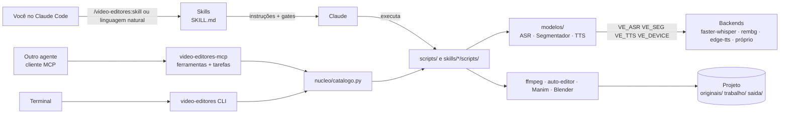

# Arquitetura

## Visão geral



Quatro camadas (0.5.0):
1. **Skills** (`skills/*/SKILL.md`): o *como* e o *quando*. Dizem o fluxo, os parâmetros, as receitas e onde parar para aprovação. O Claude lê o skill só quando ele é acionado. É a única camada que depende do modelo de linguagem (autoria de diagramas, decisões de corte).
2. **Scripts** (`scripts/`, `skills/*/scripts/`): a parte determinística (transcrição, tomadas, remap, EDL, ASS, prova). Testáveis sem o Claude; cada um roda sozinho.
3. **Núcleo** (`video_editores/`): `modelos/` com as interfaces de IA e os backends trocáveis; `nucleo/catalogo.py` com o nome estável de cada operação; `cli.py` (`video-editores <op>`), `tarefas.py` (segundo plano) e `mcp_server.py`. Não contém lógica de edição: organiza e expõe os scripts. Detalhes em [nucleo.md](nucleo.md).
4. **Ferramentas e modelos externos**: open source, por CLI ou pacote Python efêmero (`uv run --with`). Nenhum é obrigatório para quem não o usa.

## Decisões (ADRs resumidos)

### ADR-01 — Skills + scripts como base (revisto pelo ADR-11)
- **Contexto:** dava para expor as operações como um servidor MCP.
- **Decisão:** skills com scripts CLI como base.
- **Motivo:** nada para manter rodando; cada script funciona sozinho no terminal; o skill carrega contexto só quando usado; o fluxo de gates humanos fica no texto do skill, onde é fácil ajustar.
- **Consequência:** o Claude precisa de shell no computador (Claude Code). Em 0.5.0 o MCP foi adicionado **sobre** os mesmos scripts (ADR-11), sem substituir esta base: quem usa só o Claude Code continua sem nada rodando em segundo plano.

### ADR-02 — Texto em ASS/libass, nunca `drawtext`
- **Contexto:** builds estáticos do ffmpeg (johnvansickle) não têm `drawtext`; o video-docs já tinha caído nessa.
- **Decisão:** todo texto na tela vai em ASS (`lettering_ass.py`, legendas via `subtitles`).
- **Consequência:** animações (`\move`, `\t`, `\fad`) e caixas ficam mais ricas que no `drawtext`.

### ADR-03 — faster-whisper `medium` + `initial_prompt` como padrão
- **Contexto:** o video-docs validou que o `small` erra termos de domínio.
- **Decisão:** `medium` com vocabulário em `--prompt`, VAD ligado, `int8` em CPU.
- **Consequência:** download de ~1,5 GB no primeiro uso; ~1,2× o tempo real em CPU.

### ADR-04 — Dependências Python efêmeras com `uv run --with`
- **Decisão:** nenhum `requirements.txt` global; cada script declara o que usa na própria chamada.
- **Motivo:** não suja o Python do sistema, mantém versões isoladas e é a convenção do video-docs.

### ADR-05 — Licenças permissivas primeiro
- **Decisão:** preferir MIT, BSD, Apache e Unlicense; ferramentas GPL só como executáveis separados (Blender, ffmpeg); AudioCraft opcional com aviso de pesos não comerciais.
- **Consequência:** o plugin em si fica MIT, sem obrigação copyleft.

### ADR-06 — Gates humanos onde o erro é caro
- Descartar tomadas, queimar legenda, render longo e entrega passam por aprovação. O que é barato de refazer (corte, lettering) roda direto.

### ADR-07 — video-docs incorporado sem alteração
- O montador (`build.py`) entra intacto como skill. Os outros skills herdam as convenções dele (pastas, `originais/` imutável, QA por frames, privacidade).
- O ruff é configurado para aceitar o estilo compacto do `build.py`, sem reformatar.

### ADR-08 — Paralelismo em dois níveis (0.4.0)
- **Contexto:** numa videoaula de 20 min, o recorte de pessoa por IA em CPU leva horas e a autoria de 9 cenas Manim leva dezenas de minutos; subagentes não aceleram render e processos não escrevem cenas.
- **Decisão:** computação pesada em **processos** detached e dimensionados pela máquina (`matte_workers.sh N`, `render_cenas.sh -j`, `montar_aula.py --jobs`); autoria independente (uma cena por diagrama, call-outs, revisão de folhas) em **subagentes** com a mesma base e área segura; o encadeamento com dependência de dados (corte → remap → EDL → concat) e os gates continuam sequenciais.
- **Consequência:** o tempo de parede cai para o máximo entre "render em segundo plano" e "autoria", em vez da soma; o custo é a consistência visual, garantida pela base compartilhada e pela folha de verificação.

### ADR-09 — Áudio contínuo na montagem por blocos
- **Contexto:** vídeo final montado por blocos independentes (locutor, diagrama, código, cartela) codificados em separado.
- **Decisão:** o `montar_aula.py concat` junta só o vídeo dos blocos e constrói **uma** trilha de áudio a partir do corte, com silêncio/whoosh inseridos nos instantes das cartelas; fronteiras alinhadas ao frame.
- **Motivo:** AAC por bloco acumula priming e arredondamento (medido: 21 ms em 8 blocos; dezenas de blocos passam de 100 ms) e a sincronia labial no fim do vídeo é o que o aluno percebe primeiro.

### ADR-10 — Núcleo `video_editores` com interfaces de modelo (0.5.0)
- **Contexto:** cinco scripts dependiam diretamente de um motor de IA (faster-whisper, rembg, edge-tts); trocar motor ou usar GPU exigia editar cada um. Pedido de abstrair o modelo e usar modelos próprios.
- **Decisão:** três papéis com contrato (ASR, Segmentador, TTS) e backends registrados por nome, configurados por `VE_*`/`video-editores.toml`; `deps(device)` de cada backend alimenta o `uv run --with`; `codec_video()` traduz `VE_ENCODER`; `catalogo.py` nomeia cada operação e a CLI `video-editores` as executa. Scripts continuam independentes e acham o pacote por `VE_PKG_DIR` ou pela raiz do checkout.
- **Consequência:** GPU e modelo próprio viram configuração; um segundo ponto de entrada (CLI) a manter alinhado com as skills; a autoria por modelo de linguagem continua nas skills, fora da abstração.

### ADR-11 — MCP como invólucro fino com tarefas assíncronas (0.5.0)
- **Decisão:** `video-editores-mcp` expõe o catálogo como ferramentas (stdio ou streamable HTTP), operações longas voltam com id e são acompanhadas por `tarefa_*`; processos em sessão própria com código de saída em arquivo; todo caminho restrito a `--raiz`; o protocolo transporta caminhos, não mídia.
- **Motivo:** agentes sem shell local (plataforma interna com GPUs) usam as mesmas capacidades; o know-how de edição continua nas skills.
- **Consequência:** servidor e projeto compartilham storage; o modo HTTP não autentica e fica atrás de proxy/VPN.

### ADR-12 — Skills para outros agentes geradas, não mantidas à mão (0.5.0, implementado em 0.6.0)
- **Decisão:** as SKILL.md do plugin são a única fonte; `video-editores integrar codex|opencode|kiro` as copia para a pasta que cada agente lê (`.agents/skills/` para Codex e OpenCode, `.kiro/skills/` para Kiro), troca `${CLAUDE_PLUGIN_ROOT}` pelo caminho real, acrescenta um cabeçalho de execução fora do Claude Code, registra o servidor MCP no formato de cada um (`config.toml`, `opencode.json`, `mcp.json`) e grava as regras do projeto (`AGENTS.md` ou steering). Idempotente e reversível com `--remover`.
- **Motivo:** o formato SKILL.md convergiu entre os agentes (padrão Agent Skills); uma segunda cópia editada à mão divergiria em semanas.
- **Consequência:** o que é específico do Claude Code (subagentes, slash do plugin) vira orientação no cabeçalho; os gates humanos passam a depender de o agente parar e perguntar, como o texto pede. Detalhes em [agentes.md](agentes.md). ADR completo: [adr/2026-11-08-nucleo-modelos-mcp.md](adr/2026-11-08-nucleo-modelos-mcp.md).

### ADR-13 — Normalização por ganho estático + limiter de pico real; blocos no grid de quadros (0.7.0)
- **Contexto:** curso de 19 min montado por 46 blocos (cenas Manim, exemplos sintetizados, clipes gravados). O `loudnorm` em duas passadas, modo linear, entregou **+9,2 dBTP**: os degraus nas junções entre blocos viram picos que a medição da primeira passada não antecipa. As cenas do Manim saíam 1 quadro curtas e uma de 20 passos derivou 0,3 s, cortando o fim da narração.
- **Decisão:** `nucleo/audio.py`: ganho estático até o alvo LUFS e `alimiter` com oversampling (192 kHz) no teto de pico real, medido depois e repetido com teto menor se passar; fades de 12/18 ms em cada bloco; duração de bloco no grid de quadros com o último quadro clonado (`tpad`) quando a fonte é curta; relógio das cenas Manim contando quadros como o renderer. A `/prova` reprova pico real acima de −1 dBTP. AAC de entrega sem PNS (`audio.AAC`), porque o codificador nativo com PNS gerou +4,7 dBTP a partir de um wav limitado a −2,5.
- **Consequência:** `finalizar.sh` e `montar_cenas.py` passam a normalizar pelo núcleo (`normalizar-audio` também na CLI e no MCP); o `loudnorm` dinâmico fica só para filtro único em vídeo curto (`/trilha`). Áudio um pouco abaixo do alvo quando o material tem picos frequentes (o limiter age), nunca acima do teto.

### ADR-14 — Notação musical como skill com scripts determinísticos (0.8.0)
- **Contexto:** o curso de bateria precisou de partitura na tela e de um "exemplo tocado" antes de cada clipe. A primeira versão ficou no projeto (`partitura.py`, `tocar.py`, `padroes.py`) e as pegadinhas do Verovio (unidades do `qfracOn`, translate da margem, âncora do glifo) só na memória de quem fez.
- **Decisão:** skill `/partitura` com dois scripts no padrão do plugin: padrão compacto em JSON (grade em texto, manulação, acentos) → MusicXML → Verovio → cartão PNG com a posição de cada nota e de cada tempo; síntese por fórmula determinística e animação da partitura num bloco mp4 + wav com a mesma duração no grid de quadros. Rasterização com resvg (sem biblioteca de sistema, roda no CI dos dois sistemas). Integração pela via geral: o `/video-animado` aceita cena com `video` + `audio` (bloco pronto), em vez de um tipo de bloco específico de bateria.
- **Consequência:** a notação é revisável em texto (gate com quem toca) e regenerável; a convenção de cores fica no plugin. Limites explícitos: só bateria (instrumento com altura pede sampler e pauta com clave), sem tercinas, um compasso repetido por padrão.

### ADR-15 — Geração de imagem e vídeo por IA (proposto, não implementado)
- **Contexto:** pergunta recorrente: "o plugin cria vídeo generativo?" Hoje não: tudo é edição, animação por código e síntese de voz/som. Detalhe em `docs/adr/2026-11-09-geracao-por-ia.md`.
- **Proposta:** dois papéis novos em `video_editores/modelos` (`imagem`: texto → imagem; `video`: texto/imagem → clipe curto), backends locais primeiro e API opcional atrás da mesma interface, skill `/gerar` com gate por prompt e por quadro, semente e prompt gravados no projeto. Começar por imagem (fundos, B-roll estático, ilustrações para o `/video-animado`); vídeo depois, porque exige GPU com 16–24 GB e os modelos abertos ainda mudam rápido.
- **Estado:** aguarda uma máquina com GPU para validar (mesma pendência do ADR-10). Nenhum código.

### ADR-16 — Remotion avaliado, não adotado (2026-11-09)
- **Contexto:** Remotion (vídeo por React, Chrome headless + ffmpeg, skills oficiais para agentes) foi avaliado como motor de motion graphics e de legenda. Prova mínima e medições em `docs/adr/2026-11-09-remotion-poc/`; detalhe em `docs/adr/2026-11-09-remotion.md`.
- **Decisão:** não entra como dependência nem como skill. Licença source-available (gratuita só até 3 pessoas; US$ 25/mês por pessoa que escreve código Remotion, inclusive via agente, em empresa com 4+) contraria o ADR-05 e a promessa do README; queimar legenda sobre filmagem levou 318 s contra 17,6 s do `subtitles=` do ffmpeg. Cena gerada rende em velocidade comparável ao Manim e é determinística, mas não justifica Node + 518 MB + Chrome.
- **Consequência:** melhorias derivadas sem o Remotion: legenda paginada com palavra destacada em ASS no `/legenda` (`legenda_palavra.py`, **feito em 0.9.0**), specs JSON declarativas mantidas em toda skill. Revisitar se a licença mudar e um projeto exigir layout de texto que ASS/Manim não dão; nesse caso, skill opcional só para gráficos com alpha.

## Fluxo de dados

```
originais/bruto.mov
  └─ transcribe.py ─→ trabalho/bruto.transcript.json ─┬─ takes.py ─→ .takes.json ─→ render_spans.sh ─→ _tomada.mp4
                                                       ├─ /ganchos (leitura)
                                                       └─ .srt / .words.srt ─→ /legenda
_tomada.mp4 ─→ auto-editor ─→ _corte.mp4 ─→ [efeitos visuais] ─→ _lettering.mp4 ─→ _legenda.mp4
  ─→ _trilha.mp4 ─→ _efeitos.mp4 ─→ proof.sh ─→ (aprovação) ─→ saida/<slug>.mp4
```

Cada etapa lê o arquivo da etapa anterior e escreve um novo; nada é sobrescrito. Para refazer uma etapa, basta rodar de novo a partir do arquivo anterior.

Videoaula redesenhada (`/videoaula`), tudo no tempo do vídeo cortado depois do remap:
```
originais/aula.mp4 ─ scenedetect + cenas_modo.py ─→ cenas.json (locutor/quadro/codigo)
                   ─ transcribe.py ─→ .transcript.json
                   ─ auto-editor (--cut-out, --export v1) ─→ _corte.mp4 + _corte.v1.json ─ remap_tempos.py ─→ cenas_corte.json, transcript_corte.*
aula.json ─ identidade.py ─→ identidade/        matte_workers.sh ─→ mattes/talk_*.mp4 (+_alpha)       Manim (base_cenas, cartelas, diagramas) ─→ *.mov
montar_aula.py edl → render (blocos/NNN_*.mp4) → concat (vídeo concat + áudio contínuo) ─ finalizar.sh ─→ lettering → normalizar_audio.py → saida/<slug>.mp4 + legendas/<slug>.srt
```

Partitura e exemplo tocado (`/partitura`), que entram como bloco pronto no `/video-animado` ou antes de um clipe no `/videoaula`:
```
padroes.json ─ partitura.py (MusicXML → Verovio → resvg) ─→ partituras/<ID>[_big].png + .json (x,y de cada nota; x de cada tempo)
             ─ tocar.py (síntese + animação) ─→ exemplos/<ID>.mp4 + <ID>.wav (mesma duração, grid de quadros) ─→ cena {"video", "audio"} do montar_cenas.py
```

## Testes

`tests/smoke.sh` gera um vídeo sintético 1080x1920 com áudio intermitente e valida:
- `takes.py` descarta exatamente a tomada repetida;
- `render_spans.sh` produz a duração esperada;
- `lettering_ass.py` gera ASS e queima;
- `proof.sh` gera os três artefatos e reprova pico real acima de −1 dBTP (código 3); `normalizar_audio.py` conserta;
- `montar_cenas.py` fecha vídeo e áudio na duração da narração mesmo com uma cena 3 quadros curta, e usa o áudio próprio de um bloco pronto (`video` + `audio`);
- sintaxe de todos os scripts, frontmatter dos 21 skills e manifestos JSON.

`tests/docs_offline.sh` roda o montador do `video-docs` de ponta a ponta com um stub do edge-tts (`tests/stub/edge_tts.py`), então o maior script do repositório também é coberto no CI, em Linux e macOS.

`tests/partitura.sh` roda a `/partitura` de ponta a ponta com os pacotes reais via uv (Verovio + resvg para a notação; numpy + scipy para a síntese): tamanhos dos cartões, notas e tempos com posição, acentos e manulação, erros de grade, e o exemplo tocado com vídeo e wav da mesma duração no grid de quadros, AAC a 48 kHz, pico real ≤ −1,5 dBTP e síntese determinística.

`tests/nucleo.sh` cobre o pacote `video_editores`: registro e configuração dos modelos, `codec_video`, `audio.normalizar`, retry do TTS, catálogo (todo script existe), CLI, tarefas em segundo plano e o servidor MCP em processo (`tests/mcp_test.py`, cliente em memória do SDK).

Os passos com modelos de IA (Whisper, rembg, Blender) ficam fora do CI por tamanho e tempo; valide-os localmente com um vídeo curto (`video-editores transcrever clip.mp4 --model small` e `video-editores aula-recorte clip.mp4 0 1 fundo.png out`).
