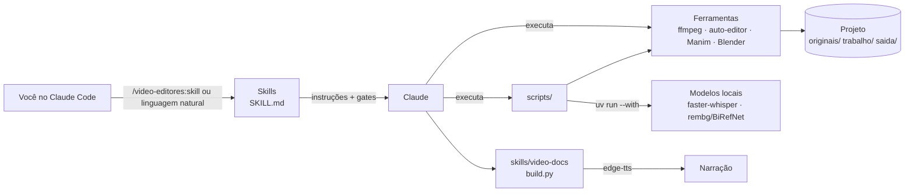

# Arquitetura

## Visão geral



Três camadas:
1. **Skills** (`skills/*/SKILL.md`): o *como* e o *quando*. Dizem o fluxo, os parâmetros, as receitas e onde parar para aprovação. O Claude lê o skill só quando ele é acionado.
2. **Scripts** (`scripts/`): a parte determinística, que não deve depender de improviso (transcrição, seleção de tomadas, montagem de trechos, ASS, prova). Testáveis sem o Claude.
3. **Ferramentas externas**: todas open source e chamadas por CLI. Nenhuma é obrigatória para os skills que não a usam.

## Decisões (ADRs resumidos)

### ADR-01 — Skills + scripts em vez de servidor MCP
- **Contexto:** dava para expor as operações como um servidor MCP.
- **Decisão:** skills com scripts CLI.
- **Motivo:** nada para manter rodando; cada script funciona sozinho no terminal; o skill carrega contexto só quando usado; o fluxo de gates humanos fica no texto do skill, onde é fácil ajustar.
- **Consequência:** o Claude precisa de shell no computador (Claude Code). Um MCP pode ser adicionado depois sobre os mesmos scripts.

### ADR-02 — Texto em ASS/libass, nunca `drawtext`
- **Contexto:** builds estáticos do ffmpeg (johnvansickle) não têm `drawtext`; o video-docs já tinha caído nessa.
- **Decisão:** todo texto na tela vai em ASS (`lettering_ass.py`, legendas via `subtitles`).
- **Consequência:** animações (`\move`, `\t`, `\fad`) e caixas ficam mais ricas que no `drawtext`.

### ADR-03 — faster-whisper `medium` + `initial_prompt` como padrão
- **Contexto:** o video-docs validou que o `small` erra termos de domínio.
- **Decisão:** `medium` com vocabulário em `--prompt`, VAD ligado, `int8` em CPU.
- **Consequência:** download de ~1,5 GB no primeiro uso; ~1,2× o tempo real em CPU.

### ADR-04 — Dependências Python efêmeras com `uv run --with`
- **Decisão:** nenhum `requirements.txt` global; cada script declara o que usa na própria chamada.
- **Motivo:** não suja o Python do sistema, mantém versões isoladas e é a convenção do video-docs.

### ADR-05 — Licenças permissivas primeiro
- **Decisão:** preferir MIT, BSD, Apache e Unlicense; ferramentas GPL só como executáveis separados (Blender, ffmpeg); AudioCraft opcional com aviso de pesos não comerciais.
- **Consequência:** o plugin em si fica MIT, sem obrigação copyleft.

### ADR-06 — Gates humanos onde o erro é caro
- Descartar tomadas, queimar legenda, render longo e entrega passam por aprovação. O que é barato de refazer (corte, lettering) roda direto.

### ADR-07 — video-docs incorporado sem alteração
- O montador (`build.py`) entra intacto como skill. Os outros skills herdam as convenções dele (pastas, `originais/` imutável, QA por frames, privacidade).
- O ruff é configurado para aceitar o estilo compacto do `build.py`, sem reformatar.

## Fluxo de dados

```
originais/bruto.mov
  └─ transcribe.py ─→ trabalho/bruto.transcript.json ─┬─ takes.py ─→ .takes.json ─→ render_spans.sh ─→ _tomada.mp4
                                                       ├─ /ganchos (leitura)
                                                       └─ .srt / .words.srt ─→ /legenda
_tomada.mp4 ─→ auto-editor ─→ _corte.mp4 ─→ [efeitos visuais] ─→ _lettering.mp4 ─→ _legenda.mp4
  ─→ _trilha.mp4 ─→ _efeitos.mp4 ─→ proof.sh ─→ (aprovação) ─→ saida/<slug>.mp4
```

Cada etapa lê o arquivo da etapa anterior e escreve um novo; nada é sobrescrito. Para refazer uma etapa, basta rodar de novo a partir do arquivo anterior.

## Testes

`tests/smoke.sh` gera um vídeo sintético 1080x1920 com áudio intermitente e valida:
- `takes.py` descarta exatamente a tomada repetida;
- `render_spans.sh` produz a duração esperada;
- `lettering_ass.py` gera ASS e queima;
- `proof.sh` gera os três artefatos;
- sintaxe de todos os scripts, frontmatter dos 14 skills e manifestos JSON.

Os passos com modelos de IA (Whisper, rembg, Blender) ficam fora do CI por tamanho e tempo; valide-os localmente com um vídeo curto.
